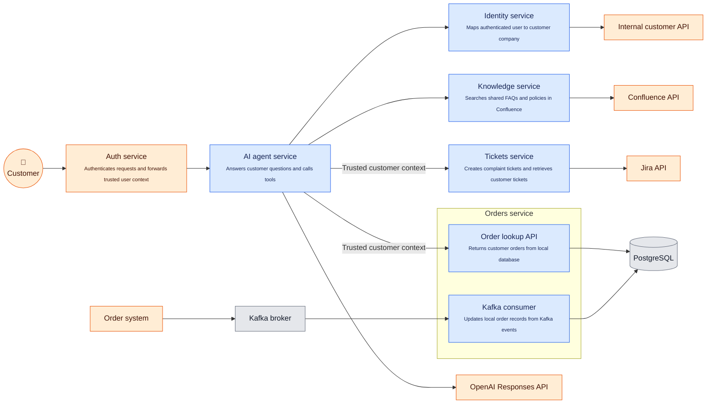

# Orders service exercise

## High level system architecture
B2B AI-only support chatbot. Run on VPS. 
Blue nodes - are app's components. Orange - external systems



## What do you need to do

You need to implement Orders service lookup API from the diagram above. This repo serves as a template:
- it has defined but not implemented API endpoints in `app/api.py`
- db models are not defined (`app/models.py`)
- incoming data examples you can find in `app/consumer.py`
- db session is configured for the app and tests

Focus on implementing:
- `app/api.py`
- `app/models.py`
- and anything else you think is relevant

## Setup and tests
Install uv. It installs Python 3.15 if needed.

```sh
uv sync --locked
uv run pytest -q
```
