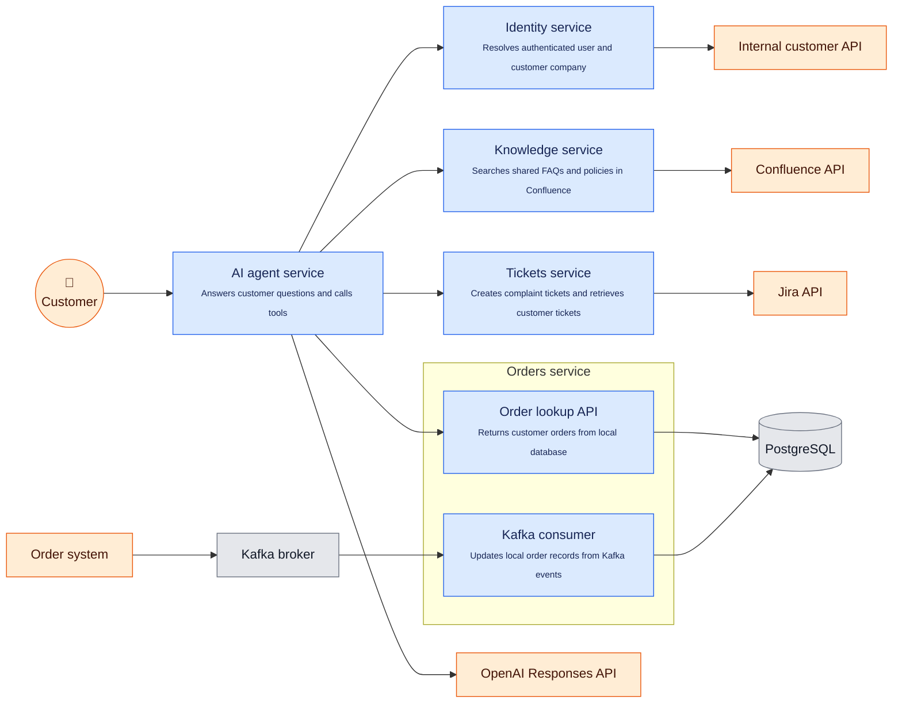

# Orders service exercise

Build a small order projection for a B2B online store. Kafka delivers full order snapshots. Customers use the API to list their orders and check an order's status.

## System context

The orders service is part of a B2B AI support chatbot running on VPSs. This repository contains only the orders service exercise.



Blue nodes are application components, orange nodes are users or external systems, and grey nodes are infrastructure.

## Your task

Define SQLAlchemy models in `app/models.py`, add validation/response models where useful, and implement:

- `handle_order_event()` in `app/consumer.py`
- `GET /orders` and `GET /orders/{order_id}` in `app/api.py`

Use async SQLAlchemy. The service targets PostgreSQL, while tests use SQLite. Use portable SQLAlchemy types and queries for this exercise. Keep the design small. How you store items is your choice. There is no product catalog, checkout, payment processing or inventory reservation.

Database sessions, Kafka transport and offset commits are supplied. `app/models.py` is empty. Order endpoints and the event handler raise `NotImplementedError` until implemented. AI tools are optional.

## Setup and tests

Install uv. It installs Python 3.15 if needed. No Docker, PostgreSQL server or Kafka broker is required for the exercise.

```sh
uv sync --locked
uv run pytest -q
uv run ruff check .
uv run ruff format --check .
```

- `tests/test_api.py` covers empty lists, ingest/read, customer-scoped lists and updated snapshots
- `tests/test_consumer.py` calls `handle_order_event()` directly and verifies the stored order through the API
- `tests/conftest.py` provides an isolated in-memory SQLite database, DB sessions, API client and order fixture

Initially, all five behavior tests fail at unfinished code. Add further coverage as time permits.

These are local behavior tests, not strict unit tests. They exercise real SQLAlchemy persistence and API responses. No Kafka clients or background consumer tasks run. The API client calls the app in-process without starting its lifespan.

Each test creates tables from your model metadata in a fresh database. Tests do not require migrations. Keep models in the default schema. Use portable types such as SQLAlchemy `JSON` rather than PostgreSQL-specific `JSONB`. For generated primary keys, SQLite requires an `Integer` column.

SQLite tests do not verify PostgreSQL-specific behavior, Kafka delivery or offset commits.

Run only the handler test:

```sh
uv run pytest tests/test_consumer.py -q
```

## Service runtime

Running the full service is optional and requires PostgreSQL and Kafka provided separately. Configuration is in `app/config.py` as module-level variables read from environment variables. Logging uses Python's `logging` module.

Alembic is configured with no migration revisions. After defining your models, set `DATABASE_URL` to your PostgreSQL connection, then generate, inspect and apply the initial migration:

```sh
uv run alembic revision --autogenerate -m "create orders"
uv run alembic upgrade head
```

Set `KAFKA_BOOTSTRAP_SERVERS` for your broker, then start the service:

```sh
uv run uvicorn app.main:app --reload
```

Open http://localhost:8000/docs. The consumer starts as an async task with the API. Use one Uvicorn worker for this exercise. The API does not create or migrate tables automatically.
